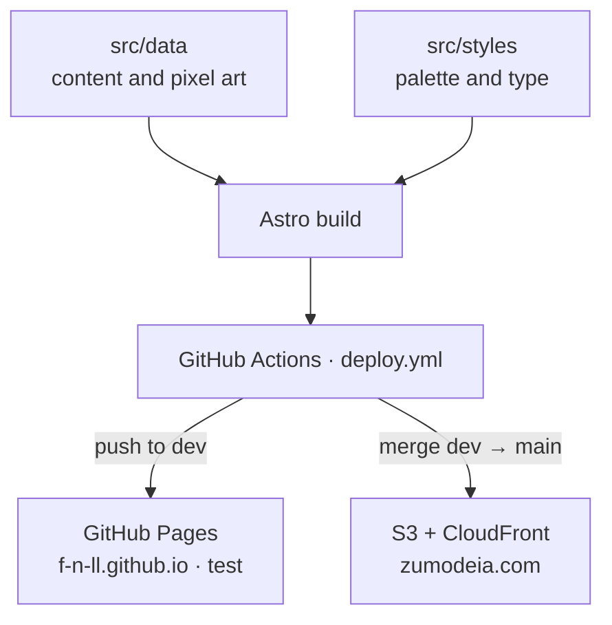

# zumodeia.com

Personal site of Daniel Fenoll. Modern fresco × Famicom. Built with Astro, deployed by `.github/workflows/deploy.yml`:

| Branch | Environment | URL |
| --- | --- | --- |
| `dev` | Dev (GitHub Pages, noindex) | https://f-n-ll.github.io |
| `main` | Release (AWS S3 + CloudFront) | https://zumodeia.com |

Work on `dev`, check it on f-n-ll.github.io, then merge `dev` → `main` to release.

- Content: `src/data/site.ts`
- Pixel art: `src/data/sprites.ts`
- Palette and type: `src/styles/global.css`

```sh
npm install
npm run dev
```

## At a glance


